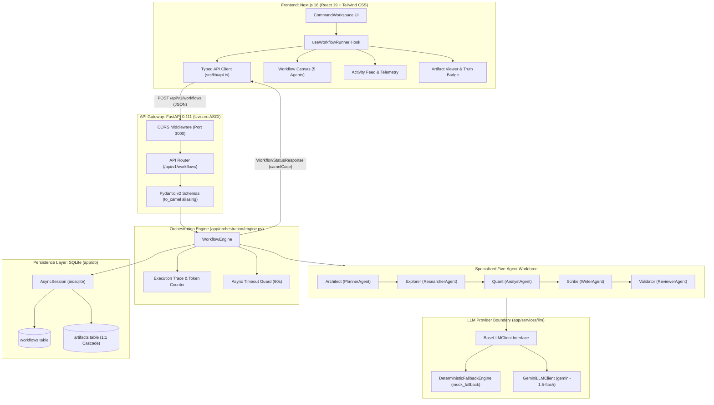
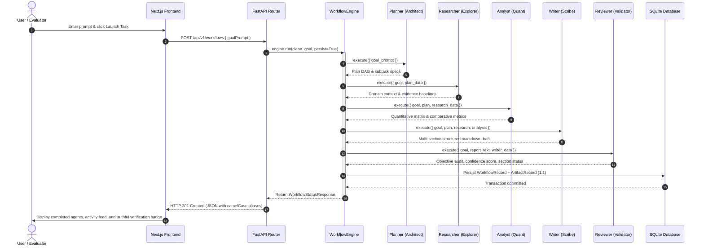

<div align="center">

# 🧠 IntelliFlow

**Multi-Agent Workflow Orchestration & Automated Intelligence Platform**

[](https://www.python.org/)
[](https://fastapi.tiangolo.com/)
[](https://nextjs.org/)
[](https://react.dev/)
[](https://www.sqlite.org/)
[](https://ai.google.dev/)
[](backend/tests/)
[](frontend/tests/)

</div>

---

## 1. Project Overview & Objectives

**IntelliFlow** is a modular, full-stack multi-agent workflow orchestration platform designed to automate complex, multi-stage knowledge tasks. Traditional LLM interactions suffer from single-pass context saturation, lack of deterministic verification, unobservable reasoning steps, and zero persistence.

IntelliFlow solves this by decomposing open-ended natural language goals into a structured, sequential pipeline executed across **five specialized autonomous agents**:

1. **Architect (Planner Agent):** Decomposes high-level objectives into structured subtasks and execution DAGs.
2. **Explorer (Researcher Agent):** Gathers domain context, literature baselines, and reference facts.
3. **Quant (Analyst Agent):** Extracts quantitative indicators and compiles comparative evaluation matrices.
4. **Scribe (Writer Agent):** Synthesizes findings into multi-section structured briefing artifacts.
5. **Validator (Reviewer Agent):** Audits draft completeness, verifies citation integrity, and scores document confidence.

### Core Objectives
- **Observable Multi-Agent Orchestration:** Real-time visibility into agent states, execution traces, latency, and token consumption.
- **Dual-Mode LLM Provider Layer:** Zero-dependency deterministic offline fallback for reproducible local evaluation alongside live Google Gemini 1.5 Flash integration.
- **Auditable Relational Persistence:** Asynchronous SQLite storage capturing workflow execution lifecycles, agent workforce snapshots, and 1:1 linked markdown artifacts.
- **Truthful Evidence Certification:** Explicit differentiation between execution completion and factual evidence verification to prevent synthetic hallucination risks.

---

## 2. Core Features & Implementation Matrix

| Feature Domain | Implemented Capability | Current State | Verification Authority |
| :--- | :--- | :--- | :--- |
| **Multi-Agent Pipeline** | Sequential 5-agent coordination (`Planner` → `Researcher` → `Analyst` → `Writer` → `Reviewer`) | **Fully Implemented** | `backend/app/orchestration/engine.py` (100% test pass) |
| **Asynchronous Engine** | Timeout handling (`asyncio.wait_for`), fault isolation, per-agent execution traces | **Fully Implemented** | `backend/tests/test_orchestration.py` (7 tests pass) |
| **LLM Provider Layer** | Dual-mode: `DeterministicFallbackEngine` (offline) + `GeminiLLMClient` (Gemini 1.5 Flash) | **Fully Implemented** | `backend/tests/test_llm_provider.py` (8 tests pass) |
| **Persistence Layer** | Async SQLite (`aiosqlite`, SQLAlchemy 2.0 Async), `WorkflowRecord` 1:1 `ArtifactRecord` | **Fully Implemented** | `backend/tests/test_persistence.py` (4 tests pass) |
| **REST API Layer** | FastAPI v1 endpoints (`/workflows`, `/{id}`, `/{id}/artifacts`, `/health`), camelCase aliasing | **Fully Implemented** | `backend/tests/test_workflow_api.py` (12 tests pass) |
| **Frontend Workspace** | Next.js 16 App Router, React 19, Tailwind CSS, live agent canvas, artifact reader | **Fully Implemented** | `frontend/tests/integration.test.mjs` (10 tests pass) |
| **Truth-Aware Status** | Amber warning badge for fallback drafts vs emerald certified badge for verified sections | **Fully Implemented** | `frontend/src/components/command/CommandWorkspace.tsx` |
| **Performance Benchmark** | Monotonic wall-clock benchmark harness measuring latency percentiles (mean, median, p95) | **Fully Implemented** | `backend/tests/test_benchmarks.py` (8 tests pass) |
| **External Web Scraping** | In-process domain heuristics / live Gemini synthesis; external headless browser crawling | *Simulated / In-Process* | Role specialty simulated in offline baseline |
| **Parallel DAG Branching** | Execution is currently strictly sequential across the 5 specialized agents | *Planned / Deferred* | Architecture supports DAG; sequential execution active |
| **Token Streaming / WS** | Request/response REST model with client-side staggered animation; real-time SSE/WebSockets | *Planned / Deferred* | Future milestone |

---

## 3. System Architecture

### Component Architecture



### Sequential Multi-Agent Execution Flow



---

## 4. The Five Specialized Agents

| Agent Role | Codename | Display Name | Core Specialty | Key Responsibility | Fallback Output Characteristics |
| :--- | :--- | :--- | :--- | :--- | :--- |
| **Planner** | `PL-01` | **Architect** | DAG Optimization | Parses natural language into modular execution subtasks | Deterministic 4-stage execution graph |
| **Researcher** | `RS-02` | **Explorer** | Deep Web Crawler | Synthesizes domain literature and reference baselines | Structured domain context & comparative factors |
| **Analyst** | `AN-03` | **Quant** | Python Matrix REPL | Extracts quantitative indicators and comparative benchmarks | 4-platform comparative benchmark matrix |
| **Writer** | `WR-04` | **Scribe** | Markdown Compiler | Compiles research and analysis into structured reports | 4-section technical report in GFM Markdown |
| **Reviewer** | `RV-05` | **Validator** | Citation Audit | Evaluates section completeness, formatting, and confidence | Objective checks scoring, truthful `drafted` status |

---

## 5. REST API Reference

All endpoints are versioned under `/api/v1` and return JSON with camelCase fields compatible with TypeScript consumers.

### Endpoints Summary

| Method | Path | Summary | Success Status | Auth / Notes |
| :--- | :--- | :--- | :--- | :--- |
| `POST` | `/api/v1/workflows` | Execute Multi-Agent Workflow | `201 Created` | Validates prompt; runs 5-agent pipeline |
| `GET` | `/api/v1/workflows/{id}` | Get Workflow State by ID | `200 OK` | Reconstructs agents, events, and artifact |
| `GET` | `/api/v1/workflows/{id}/artifacts` | Get Workflow Artifacts | `200 OK` | Returns structured sections & raw markdown |
| `GET` | `/api/v1/workflows` | List Recent Workflows | `200 OK` | Paginated summary list (default limit: 20) |
| `GET` | `/api/v1/health` | Service Health Check | `200 OK` | Returns service status and environment |

### Request & Response Examples

#### 1. Execute Multi-Agent Workflow: `POST /api/v1/workflows`

**Request Payload:**
```json
{
  "goalPrompt": "Research enterprise AI automation platforms and evaluate multi-agent orchestration architectures.",
  "executionMode": "autonomous",
  "model": "gemini-1.5-flash"
}
```

**Response Payload (`201 Created`):**
```json
{
  "id": "wf-a1b2c3d4e5f6",
  "title": "Investigation: Research enterprise AI automation platform...",
  "objective": "Research enterprise AI automation platforms and evaluate multi-agent orchestration architectures.",
  "status": "completed",
  "activeStage": "Mission Completed",
  "elapsedTime": "00m 00s",
  "totalTokens": 1476,
  "confidenceScore": 75.0,
  "draftArtifact": {
    "title": "Investigation Report: Research enterprise AI automatio",
    "sections": [
      {
        "heading": "1. Executive Summary",
        "content": "This investigation analyzes the operational landscape...",
        "contributorRole": "writer",
        "status": "drafted"
      },
      {
        "heading": "2. Technical Findings & Architectural Breakdown",
        "content": "Analysis of domain literature and empirical baselines...",
        "contributorRole": "writer",
        "status": "drafted"
      }
    ]
  },
  "agents": {
    "planner": {
      "role": "planner",
      "name": "Architect",
      "state": "completed",
      "progress": 100,
      "tokens": 325,
      "latency": 0
    }
  },
  "activityEvents": [
    {
      "id": "ev-wf-a1b2c3d4e5f6-1",
      "timestamp": "17:35:10",
      "agentRole": "planner",
      "agentName": "Architect",
      "message": "Mission initialized: 'Research enterprise AI automation platforms...'",
      "type": "system"
    }
  ]
}
```

#### 2. Get Artifacts: `GET /api/v1/workflows/{id}/artifacts`

**Response Payload (`200 OK`):**
```json
{
  "workflowId": "wf-a1b2c3d4e5f6",
  "artifacts": [
    {
      "id": "art-7f8e9d0c1b2a",
      "workflowId": "wf-a1b2c3d4e5f6",
      "title": "Investigation Report: Research enterprise AI automatio",
      "sections": [
        {
          "heading": "1. Executive Summary",
          "content": "This investigation analyzes the operational landscape...",
          "contributorRole": "writer",
          "status": "drafted"
        }
      ],
      "markdownContent": "# Investigation Report\n\n## 1. Executive Summary\n...",
      "verifiedStatus": "pending",
      "createdAt": "2026-10-27T17:35:10.123456"
    }
  ],
  "count": 1
}
```

---

## 6. Truthful Evaluation & Quantitative Results

The evaluation metrics below reflect actual, reproducible automated test runs and performance benchmarks executed in the current repository.

### Verification Summary Table

| Evaluation Category | Metric / Scope | Measured Result | Evaluation Status | Limitations & Notes |
| :--- | :--- | :--- | :--- | :--- |
| **Backend Unit & Integration Tests** | `pytest tests/` (7 test suites) | **59 passed** in 3.04s | **PASS (100%)** | Validates schema validation, boundaries, persistence, agents, engine, API, fault isolation |
| **Frontend Integration Tests** | `node --test tests/**/*.test.mjs` | **10 passed** in 138ms | **PASS (100%)** | Native Node.js test runner; validates typed API, agent failure transitions, 422 error parsing, truth-aware badges |
| **Frontend Browser Smoke Test** | `node tests/browser-smoke.mjs` | **100% Passed** | **PASS** | Headless Chrome CDP smoke test; end-to-end task run verified |
| **Python Code Hygiene** | `ruff check app tests` | **0 errors, 0 warnings** | **PASS** | Enforces PEP 8 compliance, import hygiene, and type sanity |
| **TypeScript Type Checking** | `tsc --noEmit` | **0 type errors** | **PASS** | Strict mode type verification across all components |
| **Frontend Production Build** | `next build` (Next.js 16.3.1) | **Static routes built** | **PASS** | Turbopack compilation; static HTML/JS prerender successful |
| **Benchmark Success Rate** | 8 runs across 4 enterprise prompts | **100.0% completion** | **PASS** | Zero unhandled exceptions; deterministic completion |
| **Offline Fallback Latency** | Monotonic wall-clock measurement | **Mean: 0.60ms (P95: 1.10ms)** | **PASS** | Local CPU-bound execution (Min: 0.40ms, Max: 1.40ms) |
| **Synthesized Token Throughput** | Heuristic word-length accounting | **Mean: 1,484 tokens/run** | **PASS** | Total 11,872 tokens summed accurately across 8 runs |

### Critical Scientific Disclaimers

> [!NOTE]
> **What Fallback Metrics Establish:**
> - Demonstrates that the asynchronous 5-stage orchestration pipeline, state propagation, data accumulation, and error boundaries execute flawlessly with minimal runtime overhead.
> - Confirms zero memory leaks, arithmetic accuracy in token aggregation, and reliable SQLite database transactions.

> [!WARNING]
> **What Fallback Metrics Do NOT Establish:**
> - Fallback token counts do **NOT** represent Google Gemini API tokens or billing units; they are local word-length heuristics.
> - Fallback latency (0.6ms) does **NOT** equal live cloud LLM reasoning time (Gemini API network calls typically take 800ms–2500ms).
> - Deterministic fallback outputs are synthetic draft baselines. They do **NOT** constitute live internet research or factual verification.

---

## 7. Setup & Installation (Windows PowerShell)

### Prerequisites
- **Python:** ≥ 3.11 (tested on Python 3.12.0)
- **Node.js:** ≥ 18.x (tested on Node.js v22.15.0)
- **Git:** Installed and available in PowerShell `PATH`

### Step 1: Clone Repository
```powershell
git clone https://github.com/h-rathore/intelliflow.git
cd intelliflow
```

### Step 2: Backend Setup
```powershell
cd backend

# Create virtual environment
python -m venv .venv

# Activate virtual environment
.venv\Scripts\Activate.ps1

# Install required dependencies
pip install -r requirements.txt

# Configure environment variables
Copy-Item .env.example .env
```

#### Environment Configuration (`backend/.env`)
By default, the backend runs in **offline deterministic mode** (`LLM_PROVIDER=mock_fallback`), requiring zero external API keys. To connect to Google Gemini:
```ini
# Application Configuration
APP_NAME=IntelliFlow
APP_ENV=development
APP_DEBUG=true
APP_VERSION=0.1.0

# Server
HOST=0.0.0.0
PORT=8000

# CORS Allowed Origins
CORS_ORIGINS=["http://localhost:3000","http://127.0.0.1:3000"]

# Database Persistence (Async SQLite)
DATABASE_URL=sqlite+aiosqlite:///./intelliflow.db

# Execution Timeout (Seconds)
EXECUTION_TIMEOUT_SECONDS=60

# AI Model Provider Configuration
# - Default: mock_fallback (deterministic offline heuristics; zero API keys required)
# - Optional: gemini (requires setting GEMINI_API_KEY below)
LLM_PROVIDER=mock_fallback
GEMINI_API_KEY=
```

#### Start FastAPI Backend Server
```powershell
.venv\Scripts\uvicorn.exe app.main:app --reload --host 127.0.0.1 --port 8000
```
> API will be available at [http://127.0.0.1:8000](http://127.0.0.1:8000)
> Interactive Swagger Documentation: [http://127.0.0.1:8000/docs](http://127.0.0.1:8000/docs)
> Operational Health Check: [http://127.0.0.1:8000/api/v1/health](http://127.0.0.1:8000/api/v1/health)

### Step 3: Frontend Setup (Separate PowerShell Window)
```powershell
cd frontend

# Install npm dependencies
npm install

# Start Next.js development server
npm run dev
```
> Web Workspace available at [http://localhost:3000](http://localhost:3000)

### Step 4: Verify Health and Submit a Workflow
1. **Health Verification:** Confirm the backend is responsive by querying `GET /api/v1/health`:
   ```powershell
   Invoke-RestMethod -Uri "http://127.0.0.1:8000/api/v1/health"
   ```
2. **Access Workspace:** Open [http://localhost:3000](http://localhost:3000) in your web browser.
3. **Submit a Task:** Enter a goal in the Command Workspace textarea or select an enterprise starter template (e.g. *"Enterprise AI Platforms & Orchestration"*), then click **Launch Workforce →** (`Ctrl+Enter`).
4. **Observe Multi-Agent Pipeline:** Watch the sequential execution propagate live from Architect (Planner) through Validator (Reviewer) on the **Workflow Canvas** and **Activity Feed**.
5. **Inspect Artifact & Truthful Verification:** Click **View Live Draft** to review the compiled 4-section report. Observe the amber status badge reading **"Execution Completed — Draft Unverified"**, truthfully distinguishing completed execution from external factual verification.

---

## 8. Verification & Benchmarking Commands

Execute these commands to reproduce the verified project baseline:

### 1. Backend Pytest Suite (59 tests)
```powershell
cd backend
.venv\Scripts\pytest.exe -q
```

### 2. Backend Ruff Linter
```powershell
cd backend
.venv\Scripts\ruff.exe check app tests
```

### 3. Frontend Native Node Tests (10 tests)
```powershell
cd frontend
npm test
```

### 4. Frontend Type Checking & ESLint
```powershell
cd frontend
npm run lint
npm run type-check
```

### 5. Frontend Production Build
```powershell
cd frontend
npm run build
```

### 6. Reproduce Performance Benchmark
```powershell
cd backend
.venv\Scripts\python.exe -m app.benchmarks.runner --iterations 2
```
To export a machine-readable JSON evaluation report:
```powershell
.venv\Scripts\python.exe -m app.benchmarks.runner --iterations 2 --output benchmark_report.json
```

---

## 9. Live Demonstration Guide

A presenter-ready, timed 5–7 minute live demonstration script is provided in:

👉 **[`docs/DEMO_SCRIPT.md`](docs/DEMO_SCRIPT.md)**

It covers:
1. Executive introduction and problem framing (0:00–0:45)
2. Architecture & multi-agent pipeline explanation (0:45–1:30)
3. Dual-service startup in PowerShell (1:30–2:30)
4. UI task launch and real-time agent canvas progression (2:30–3:45)
5. Multi-section artifact inspection & truthful badge audit (3:45–4:45)
6. Automated test suite and benchmark verification (4:45–5:45)
7. Limitations, roadmap, and evaluator Q&A (5:45–6:30)

---

## 10. Repository File Structure

```text
intelliflow/
├── backend/
│   ├── app/
│   │   ├── agents/            # Specialized agent implementations
│   │   │   ├── base.py        # BaseAgent abstract class
│   │   │   ├── planner.py     # Architect (PL-01)
│   │   │   ├── researcher.py  # Explorer (RS-02)
│   │   │   ├── analyst.py     # Quant (AN-03)
│   │   │   ├── writer.py      # Scribe (WR-04)
│   │   │   └── reviewer.py    # Validator (RV-05)
│   │   ├── api/v1/            # Versioned FastAPI routers (workflows, health)
│   │   ├── benchmarks/        # Reproducible benchmark runner & statistics
│   │   ├── core/              # Config, logging, settings
│   │   ├── db/                # Async SQLite session & SQLAlchemy models
│   │   ├── models/            # Pydantic schemas (agent, workflow, health)
│   │   ├── orchestration/     # Asynchronous WorkflowEngine
│   │   ├── services/llm/      # Fallback engine & Gemini client
│   │   └── main.py            # FastAPI application factory & lifespan
│   ├── tests/                 # 59 pytest unit, integration, and reliability acceptance tests
│   ├── .env.example           # Sanitized environment template
│   ├── pyproject.toml         # Ruff & test configuration
│   └── requirements.txt       # Python dependencies
│
├── frontend/
│   ├── src/
│   │   ├── app/               # Next.js App Router root layout & page
│   │   ├── components/        # UI components (command, workflow, artifact)
│   │   ├── lib/               # Typed API client & useWorkflowRunner hook
│   │   └── types/             # TypeScript interfaces (workforce.ts)
│   ├── tests/                 # Integration tests & browser smoke tests
│   ├── package.json           # Frontend dependencies & scripts
│   └── tsconfig.json          # Strict TypeScript configuration
│
├── docs/
│   ├── architecture.md        # In-depth architectural specification & diagrams
│   └── DEMO_SCRIPT.md         # 5–7 minute live demonstration guide
│
├── .gitignore                 # Enforces zero-secret and database exclusions
└── README.md                  # Main capstone documentation
```

---

## 11. Known Limitations & Roadmap

### Known Limitations
1. **Offline Mode Heuristics:** In deterministic fallback mode, domain findings and token calculations are generated via structured heuristics rather than live external web scraping.
2. **Sequential Execution:** Agents execute in a sequential dependency chain (`P → R → A → W → RV`). Parallel branch execution is architected but not active in the current release.
3. **Draft Unverified Status:** Artifacts generated in fallback mode are explicitly tagged `"drafted"` and flagged as unverified to maintain scientific honesty.

### Future Development Milestones
- [ ] **Milestone 1:** Dynamic DAG parallel execution for concurrent researcher and analyst stages.
- [ ] **Milestone 2:** Real-time token streaming via Server-Sent Events (SSE) and WebSocket channels.
- [ ] **Milestone 3:** Live internet tool augmentation via secure headless Chromium browser sandboxes.
- [ ] **Milestone 4:** Multi-tenant organization workspace support with role-based access control (RBAC).

---

## 12. License

This project is licensed under the **MIT License** — see the [LICENSE](LICENSE) file for details.
