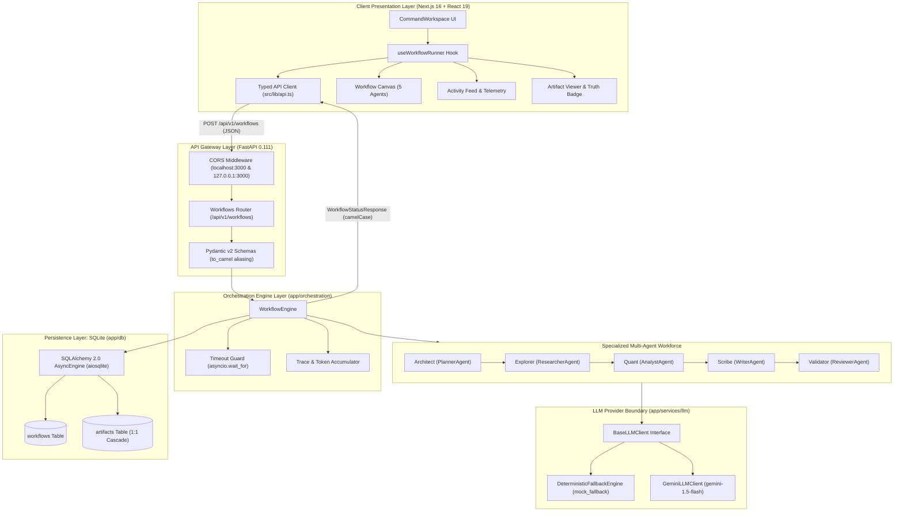
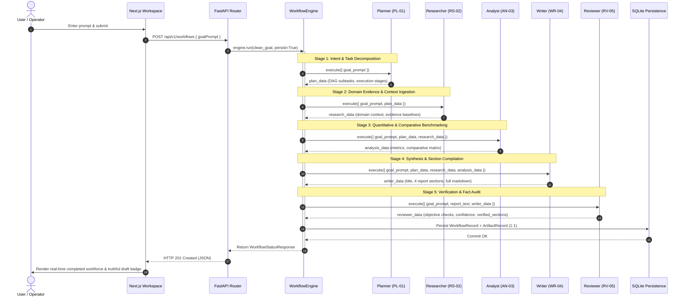
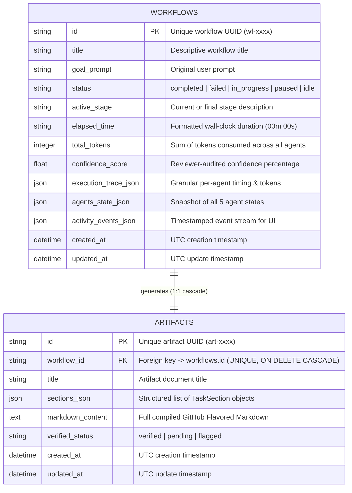
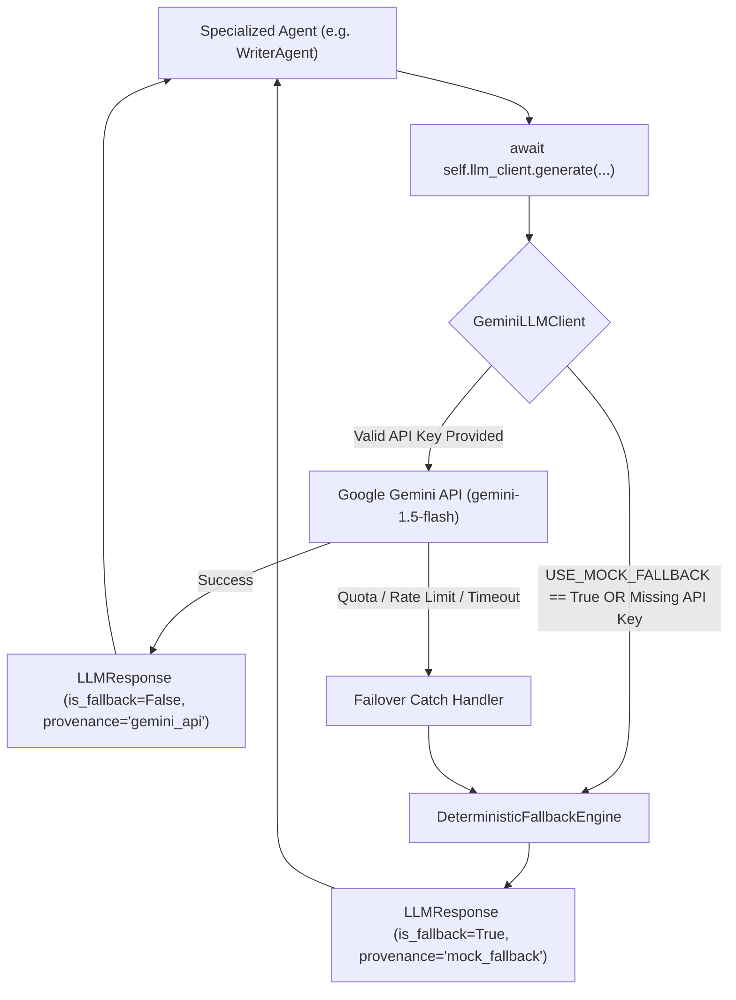

# IntelliFlow — System Architecture & Design Specification

> **Platform Version:** 0.1.0
> **Engineering Phase:** Verified Mid-Term Implementation Checkpoint
> **Repository:** `https://github.com/h-rathore/intelliflow`

---

## 1. Architectural Philosophy & Design Principles

IntelliFlow is designed to bridge the gap between experimental single-turn LLM prompts and deterministic, verifiable multi-agent workflows. The system adheres to four foundational engineering principles:

1. **Separation of Concerns:**
   Agent decision logic, LLM inference providers, orchestration scheduling, state persistence, and client presentation are decoupled into discrete layers. Agents never directly call SQLite or manage HTTP connections; the orchestration engine mediates all state and persistence.
2. **Deterministic Offline Baselines & Fault Isolation:**
   Cloud LLM providers are susceptible to rate limits, network outages, and token quota exhaustion. IntelliFlow implements a dual-mode LLM abstraction (`DeterministicFallbackEngine` alongside `GeminiLLMClient`). If an API key is missing or an upstream request fails, the engine gracefully falls back to deterministic, offline execution with zero pipeline crashes.
3. **Auditable Relational Persistence:**
   Transient agent thoughts and intermediate findings are systematically persisted to an asynchronous SQLite relational store (`WorkflowRecord` and `ArtifactRecord`). Every run can be inspected, reloaded, or audited by workflow ID.
4. **Truthful Evidence Certification:**
   Synthetic fallback generation is clearly differentiated from verified external fact-checking. When running in offline or draft mode, generated artifacts are tagged as `"drafted"` and flagged with `"Draft Unverified"` in the user interface. Verification certification (`"Execution Certified"`) is strictly reserved for artifacts where every section has passed authentic, external fact auditing.

---

## 2. High-Level System Architecture



---

## 3. Component Deep Dive

### 3.1 Client Presentation Layer (`frontend/`)

- **Framework:** Next.js 16.3.1 (Turbopack) with React 19 and TypeScript in strict mode.
- **Styling:** Tailwind CSS with atomic utility classes and dynamic status color tokens.
- **`src/lib/api.ts`:** Typed HTTP client utilizing native `fetch`. Implements:
  - `createWorkflow(goalPrompt: string)`: Submits execution requests to `POST /api/v1/workflows`.
  - `getWorkflow(id: string)`: Retrieves state from `GET /api/v1/workflows/{id}`.
  - `getWorkflowArtifacts(id: string)`: Fetches full markdown from `GET /api/v1/workflows/{id}/artifacts`.
  - `listRecentWorkflows(limit?: number)`: Queries recent execution history.
- **`src/lib/useWorkflowRunner.ts`:** React state management hook orchestrating:
  - Input validation (rejects empty or whitespace-only submissions before network dispatch).
  - Network state dispatch and loading state propagation.
  - Staggered presentation transitions (~400ms per agent) so evaluators observe the visual progression from Planner through Reviewer.
  - Dynamic telemetry mapping: token counts, wall-clock elapsed time, and confidence scoring.
- **`src/components/command/CommandWorkspace.tsx`:** Primary operator console containing:
  - Natural language goal input and starter enterprise templates.
  - Dual-mode verification badge logic:
    ```typescript
    const isArtifactVerified =
      (taskContext.draftArtifact?.sections?.length ?? 0) > 0 &&
      taskContext.draftArtifact?.sections?.every((s) => s.status === 'verified');
    ```
    - Renders `"Execution Completed — Draft Unverified"` (`warning` amber badge) when sections are in fallback or unverified draft state.
    - Renders `"Execution Certified"` (`success` emerald badge) strictly when all sections are verified.

### 3.2 API Gateway Layer (`backend/app/api/`)

- **Framework:** FastAPI 0.111 running on Uvicorn ASGI.
- **Lifespan Management (`app/main.py`):**
  - Initializes database schema idempotently (`await init_db()`) during application startup.
  - Configures structured logging.
  - Gracefully disposes connection pools upon server shutdown (`await engine.dispose()`).
- **CORS Configuration:**
  - Whitelists both `http://localhost:3000` and `http://127.0.0.1:3000` to prevent cross-origin preflight rejections.
- **Serialization & Schema Mapping:**
  - Pydantic v2 models with `alias_generator=to_camel` and `populate_by_name=True`.
  - Eliminates manual field translation between backend Python snake_case and frontend TypeScript camelCase.

### 3.3 Orchestration Engine Layer (`backend/app/orchestration/`)

- **`WorkflowEngine` (`engine.py`):**
  - Manages sequential pipeline execution across the 5 specialized agents.
  - Enforces execution timeout via `asyncio.wait_for(..., timeout=timeout_seconds)` (default: 60s).
  - Tracks monotonic wall-clock duration via `time.perf_counter()`.
  - Dynamically updates agent states (`waiting` → `working` → `completed` or `failed`).
  - Records granular, timestamped `ActivityEvent` records for the UI activity feed.
  - Accumulates total token counts across all agent execution stages.
  - Handles agent failure isolation: if any agent fails, the pipeline halts gracefully, persists the partial failure trace, and returns a structured failure response rather than crashing the server.

---

## 4. Multi-Agent Pipeline & Data Flow

The five agents operate as a sequential dependency chain where each agent enriches the shared execution context:



### Agent Specification Matrix

| Agent | Codename | Role | Input Contract | Output Payload |
| :--- | :--- | :--- | :--- | :--- |
| **Planner** | `PL-01` | `planner` | `{"goal_prompt": str}` | Subtask DAG, target stages, execution priority |
| **Researcher** | `RS-02` | `researcher` | `{"goal_prompt": str, "plan_data": dict}` | Domain literature, reference baselines, key entities |
| **Analyst** | `AN-03` | `analyst` | `{"goal_prompt": str, "plan_data": dict, "research_data": dict}` | Quantitative indicators, comparative capability matrix |
| **Writer** | `WR-04` | `writer` | `{"goal_prompt": str, "plan_data": dict, "research_data": dict, "analysis_data": dict}` | 4 report sections, title, full markdown compilation |
| **Reviewer** | `RV-05` | `reviewer` | `{"goal_prompt": str, "report_text": str, "writer_data": dict}` | Objective checks (completeness, format, provenance), confidence score (0–100%), verified sections |

---

## 5. Persistence Layer & Entity-Relationship Schema

The database layer utilizes **SQLAlchemy 2.0 Async** coupled with **`aiosqlite`**. Table structures are defined in `backend/app/db/models.py`.



### Relational Invariants
1. **1:1 Strict Cascade Relationship:** Every `ArtifactRecord` is tied to a single `WorkflowRecord` via `workflow_id (unique=True)`. Deleting a workflow automatically cascades to its associated artifact.
2. **JSON Snapshotting:** To eliminate complex joins during real-time UI polling, agent snapshots and activity feeds are serialized as structured JSON directly within the `WorkflowRecord`.
3. **Idempotent Initialization:** The `init_db()` function executes `create_all()` asynchronously on startup, ensuring local development databases are provisioned automatically without manual migration scripts.

---

## 6. LLM Provider Layer & Fallback Engine



### Key Provider Attributes
- **Zero-Dependency Fallback:** Generates syntactically valid, deterministic markdown sections with realistic structure, headings, and quantitative comparison tables.
- **Provenance Transparency:** Every `LLMResponse` contains explicit `is_fallback: bool` and `provenance: str` metadata. The reviewer agent inspects this metadata to ensure synthetic content is never certified as externally verified evidence.
- **Failover Safety:** If an active Gemini API call fails due to rate-limiting (`HTTP 429`) or quota exhaustion, `GeminiLLMClient` catches the exception and transparently delegates to `DeterministicFallbackEngine`, preventing user-facing 500 errors.

---

## 7. Performance Benchmarking & Evaluation Methodology

The benchmarking subsystem (`backend/app/benchmarks/runner.py`) provides reproducible quantitative measurement:

1. **Monotonic Wall-Clock Measurement:** Uses Python's `time.perf_counter()` to capture sub-millisecond execution times without susceptibility to system clock adjustments.
2. **Statistical Aggregation:** Computes mean, median, min, max, and P95 latencies (via linear interpolation) across multiple prompt iterations.
3. **Zero Secret Leaking:** Inspects and sanitizes all exported configuration fields, masking API keys and passwords.
4. **Isolated Database Persistence:** Benchmarks execute with `persist=False` by default to prevent benchmark runs from polluting the active development database.

### Benchmark Results (Deterministic Fallback Mode)
- **Runs:** 8 iterations across 4 enterprise workflow prompts.
- **Success Rate:** 100.0% (8 completed, 0 failed).
- **Latency Distribution:**
  - Mean: `0.0006s` (0.60ms)
  - Median: `0.0005s` (0.50ms)
  - Min: `0.0004s` (0.40ms)
  - Max: `0.0014s` (1.40ms)
  - P95: `0.0011s` (1.10ms)
- **Token Summation:** 11,872 tokens (mean 1,484 tokens/run).

---

## 8. Failure Recovery & Resilience Patterns

| Failure Scenario | Mitigation Mechanism | System Outcome |
| :--- | :--- | :--- |
| **Empty or Whitespace Goal** | Pre-validation in `api/v1/workflows.py` | Returns `HTTP 422 Unprocessable Entity`; zero backend resources wasted. |
| **Pipeline Stage Timeout** | `asyncio.wait_for(timeout=60.0)` in `engine.py` | Pipeline halts safely; marks workflow as `failed`; persists partial trace to SQLite; returns structured failure response. |
| **Agent Execution Exception** | Individual `try/except` in `_execute_pipeline` | State mapped to `AgentState.FAILED`; activity feed records failure event; downstream agents halted. |
| **Gemini API Outage / Rate Limit** | Try/catch in `GeminiLLMClient.generate` | Graceful fallback to `DeterministicFallbackEngine`; provenance flagged as synthetic; workflow succeeds. |
| **Database Transaction Failure** | `async with session.begin():` context manager | Atomic rollback on error; prevents dangling orphaned workflow records. |
| **Client Disconnect** | Asynchronous task execution on FastAPI | Workflow completes in background; persistent record available on reconnect via ID lookup. |

---

## 9. Security & Production Considerations

1. **Sanitized Configuration:** `.env.example` contains zero secrets. Live credentials are never committed to version control.
2. **Input Sanitization:** Strips leading/trailing whitespace and limits title lengths to prevent buffer saturation.
3. **CORS Isolation:** Development origins are restricted explicitly to frontend dev ports (`http://localhost:3000` and `http://127.0.0.1:3000`). Wildcard `*` origins are avoided.
4. **SQL Injection Prevention:** Uses SQLAlchemy 2.0 parameterized queries exclusively (`select(WorkflowRecord).where(...)`), completely eliminating raw SQL formatting vulnerabilities.
