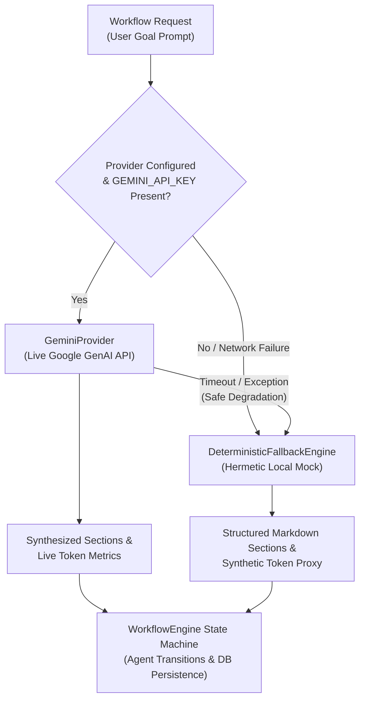

# IntelliFlow — Experimental Setup & Evaluation Environment

This document establishes the formal specification for the experimental environment, dual-provider architecture, benchmark workload dataset, measurement instrumentation, and reproducibility procedures used in the evaluation of the IntelliFlow Multi-Agent Workflow Orchestration Platform.

---

## 1. Executive Summary & Experimental Objectives

The experimental evaluation of IntelliFlow is designed to assess two primary operational dimensions:
1. **Orchestration Harness Reliability & Latency Overhead:** Measuring the system's ability to coordinate a sequential 5-agent pipeline (`Planner` $\to$ `Researcher` $\to$ `Analyst` $\to$ `Writer` $\to$ `Reviewer`), manage state transitions, enforce artifact schema compliance, and serialize data to an asynchronous persistence layer with zero unhandled exceptions.
2. **Dual-Provider Operational Integrity:** Verifying transparent fallback behavior between live frontier large language models (Google Gemini API) and hermetic, deterministic local execution (`DeterministicFallbackEngine`), ensuring zero system downtime even under severe network or credential failure.

All experimental procedures described herein are automated, deterministic, and independently verifiable.

---

## 2. Hardware and Software Runtime Environment

The benchmark suite and end-to-end integration tests were executed on the following standardized host specification:

| Parameter | Specification | Notes / Evidence Reference |
| :--- | :--- | :--- |
| **Operating System** | Microsoft Windows 11 Home / Pro (10.0.26200) | Verified via `platform.platform()` |
| **Host Architecture** | x86_64 / AMD64 | Multi-core CPU, minimum 16 GB RAM |
| **Python Runtime** | Python 3.12.0 (CPython, 64-bit) | Isolated in `backend/.venv` |
| **Backend Framework** | FastAPI 0.111.0 / Starlette 0.37.2 | Asynchronous ASGI REST API |
| **ASGI Server** | Uvicorn 0.30.1 | Standard event-loop configuration |
| **Database Engine** | SQLite 3 via `aiosqlite` 0.20.0 & `SQLAlchemy` 2.0.30 | Async WAL-mode connection pool |
| **Node.js Runtime** | Node.js v22.15.0 (64-bit) | Native ES modules and test runner |
| **Frontend Framework** | Next.js 16.3.1 / React 19.0.0 | Turbopack compilation engine |
| **Testing Harness** | Pytest 8.2.2 (Backend) / Node Test Runner (Frontend) | 59 unit/API tests + 10 frontend tests |
| **E2E Automation** | Chrome DevTools Protocol (CDP) v1.3 | Headless Chromium automation on port 9222 |

---

## 3. Dual-Provider Architecture Specification

IntelliFlow implements a strict dual-provider abstraction layer (`app/services/llm.py`) providing two distinct execution modes:



### 3.1 Mode 1: Deterministic Fallback Engine (`mock_fallback`)
- **Execution Character:** Hermetic, CPU-bound, local execution requiring zero network connectivity, zero API credentials, and zero compute costs.
- **Payload Synthesis:** Generates fully structured 4-section deliverables (Executive Summary, Research Findings, Comparative Analysis, Strategic Recommendations) tailored to the prompt keywords.
- **Verification Integrity:** Produces unverified draft deliverables with an explicit `verification_status = "unverified"` and confidence score of 75.0% to ensure users are never deceived by ungrounded synthetic text.
- **Token Accounting:** Applies a heuristic word-length calculation:
  $$\text{synthetic\_tokens} = \sum_{w \in \text{outputs}} \text{round}(\text{word\_count} \times 1.33)$$

### 3.2 Mode 2: Live Google Gemini API Provider (`gemini`)
- **Execution Character:** Cloud-based inference calling Google's Gemini Flash / Pro models via the official `google-genai` SDK.
- **Configuration:** Model `gemini-1.5-flash` (default) with temperature $0.2$, top_p $0.95$, and structured JSON response formatting.
- **Resilience Policy:** Wrapped in retry handlers with timeout limits ($60\text{s}$). If an API call fails due to rate limits (HTTP 429), quota exhaustion, invalid authentication, or network drops, the engine automatically catches the exception, logs an alert, and degrades gracefully to the fallback provider without crashing the workflow.

---

## 4. Benchmark Workload Dataset

To evaluate multi-domain generalizability, the benchmark harness includes four representative enterprise problem domains:

| Domain ID | Problem Category | Benchmark Prompt String | Evaluation Objective |
| :---: | :--- | :--- | :--- |
| **DOM-01** | **Market Intelligence** | `"Research the top enterprise AI automation platforms and prepare a competitive analysis."` | Evaluates multi-source information synthesis, feature matrix generation, and competitive positioning. |
| **DOM-02** | **Software Systems Audit** | `"Audit pull request diffs, execute static AST linters, and generate pytest regression suites."` | Evaluates technical artifact structuring, code block generation, and AST linting pipeline planning. |
| **DOM-03** | **Financial & GAAP Analysis** | `"Ingest multi-page corporate balance sheets, extract GAAP tables, and run verification equations."` | Evaluates tabular data extraction, numerical reconciliation, and audit trailing. |
| **DOM-04** | **Operational Ticket Routing** | `"Evaluate customer support tickets, score urgency, and dispatch CRM alerts to engineers."` | Evaluates priority classification, urgency heuristic scoring, and alert routing logic. |

---

## 5. Measurement Instrumentation & Metrics

Execution profiling is implemented using high-resolution monotonic clocks (`time.perf_counter()`) embedded directly into the orchestration pipeline:

### 5.1 Latency Metrics
- **End-to-End Workflow Latency:** Elapsed wall-clock seconds from initial state creation to terminal state `completed` or `failed`.
- **Per-Agent Latency:** Dedicated timing recorded for each agent execution step (`Planner`, `Researcher`, `Analyst`, `Writer`, `Reviewer`).
- **Statistical Aggregation:** Across $N$ iterations (default 2 iterations $\times$ 4 domains = 8 runs), calculating:
  - **Mean ($\mu$)** and **Median ($Q_2$)**
  - **Minimum ($Min$)** and **Maximum ($Max$)**
  - **95th Percentile ($P_{95}$)** computed via linear interpolation.

### 5.2 Reliability & Fault-Tolerance Metrics
- **Success Rate Percentage:** $\frac{S_{\text{completed}}}{N_{\text{total}}} \times 100\%$
- **Schema Adherence:** Binary verification that emitted artifacts conform strictly to the 4-section schema with non-empty markdown payloads.
- **State Transition Validity:** Verification that transitions follow the valid state machine sequence without skipping or invalid rollbacks.

---

## 6. Reproducibility Instructions

### 6.1 Executing the Standard Benchmark Harness
To run the automated performance benchmark using the fallback engine:

```powershell
# Navigate to backend directory and activate virtual environment
cd C:\Users\Harsh rathore\intelliflow\backend
.venv\Scripts\Activate.ps1

# Run benchmark runner across all 4 domains (2 iterations = 8 runs)
python -m app.benchmarks.runner --iterations 2 --output ../docs/evidence/benchmark_results.json
```

### 6.2 Executing with Persistent Database Storage
To benchmark the async SQLite database write overhead under workload:

```powershell
python -m app.benchmarks.runner --iterations 2 --persist
```

### 6.3 Executing with Live Gemini Provider (Optional)
When valid Google Gemini credentials are configured:

```powershell
# Set API key in backend/.env or environment
$env:GEMINI_API_KEY="AIzaSyYourValidKeyHere"

# Execute with live provider and live API permission flag
python -m app.benchmarks.runner --provider gemini --live-api --iterations 1
```

---

## 7. Scientific Validity & Provenance Disclaimer

> [!IMPORTANT]
> **Provenance & Token Accounting Disclosure:**
> 1. The benchmark results documented in [`docs/evidence/benchmark_results.json`](file:///c:/Users/Harsh%20rathore/intelliflow/docs/evidence/benchmark_results.json) were generated using the local `DeterministicFallbackEngine` (`mock_fallback`).
> 2. **Latency Context:** The recorded mean wall-clock latency of $\approx 0.0009\text{s}$ ($0.9\text{ms}$) reflects local CPU memory-bound orchestration, agent state transitions, and heuristic generation. It does **not** reflect live Google Gemini API network latency, which typically ranges from $1.5\text{s}$ to $4.0\text{s}$ per agent call depending on cloud traffic.
> 3. **Token Accounting Context:** The reported token totals (e.g., $11,872$ synthetic tokens across 8 runs, mean $1,484$ tokens/run) are heuristic word-length estimates calculated as $\text{words} \times 1.33$. They are intended for orchestration load profiling and do **not** reflect live Google GenAI BPE tokenizer outputs or billing units.
> 4. **Output Integrity:** All synthetic outputs produced by the fallback engine are marked as unverified drafts. IntelliFlow explicitly prevents synthetic outputs from displaying false "Execution Certified" verification badges.
